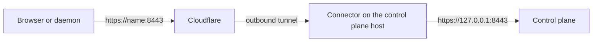

# Control Plane Tunnel

Your control plane can live on a server with no open ports: behind a home router, inside an office network, or on a machine that has no public address at all. Give TurboPanel one Cloudflare API token and it does the rest. It creates the tunnel, writes the DNS record, starts the connector on the control plane host and keeps an eye on it from then on. You never copy a tunnel ID or edit a config file.

This page is about the **control plane's own address**, the one you sign in to. It is set up under Admin → **Access** and is for self-hosted control planes only. Tunnels for your hosted sites are a separate feature, set up per organization: see [Cloudflare Tunnels](/docs/deployment/tunnels).

<Callout type="info" title="Self-hosted only">
  TurboPanel High Availability already runs on a global edge network, so there is no control plane
  host to put a tunnel on. The **Tunnel** screen there says so and changes nothing.
</Callout>

## How It Works

A small connector program runs next to the control plane and holds an outbound connection to Cloudflare. People and servers reach your control plane's name at Cloudflare, and Cloudflare sends the traffic down that connection. Nothing reaches in from the internet, so ports 80, 443 and 8443 can stay closed on your router and your firewall.

- **One tunnel per Cloudflare account.** Every control plane name you connect through the same account rides the same tunnel. It is named `turbopanel-control-plane-` followed by the start of this control plane's ID, so you can spot it in the Cloudflare dashboard.
- **The connector runs on the control plane host only.** The daemon there starts it. The tunnel's run token is sent to that daemon and nowhere else; your other servers never receive it.
- **The address stays the same.** A name is still opened at `https://<name>:8443`, exactly as on the [Hostnames](/docs/deployment/hostnames-and-tls) page.
- **Visitor addresses are kept.** The control plane takes the visitor's real address from the local connector, so it sees the person, not Cloudflare.
- **Daemon connections stay open.** Cloudflare closes a connection that is quiet for 100 seconds. While any control plane name uses a tunnel, the control plane asks its daemons to send a heartbeat every 25 seconds instead of every 60. There is nothing to set.

## Before You Begin

- A self-hosted control plane whose daemon on the same host is connected.
- A domain on Cloudflare: its DNS must be hosted there. The name you want, such as `panel.example.com`, must be inside that zone.
- The name saved on Admin → **Access** → **Hostnames**.
- **Edge modes are ready.** The Hostnames page says so in one line under its text. See [Edge Modes Wait for Your Servers](#edge-modes-wait-for-your-servers) when it does not.

## Create the API Token

In Cloudflare, create an API token. An **account-owned token** (made on the account's API Tokens page) is the better choice, because it keeps working when the person who made it leaves. A **user-owned token** (made under your profile) works too.

Give it these permissions:

| Permission | Where | Why |
| --- | --- | --- |
| **Account** → **Cloudflare Tunnel** → **Edit** | The account | Create the tunnel, set its routes and get the connector's run token. A tunnel belongs to the account, so this permission must cover the account, not just a zone. |
| **Account** → **Account API Tokens** → **Read** | The account | Lets TurboPanel read the token's own permissions and tell you exactly what is missing. For a user-owned token, use **User** → **API Tokens** → **Read** instead. |
| **Zone** → **DNS** → **Edit** | The zones that hold your control plane's names | Point each name at the tunnel, and answer the DNS challenge for [DNS-01](#certificates) certificates. |

**Extra permissions are fine.** A token may carry more than this list, and the control plane only uses what it needs. If DNS Edit covers every zone of the account, the check still passes and simply notes that the token can do more than it has to. A narrower token is still the safer choice: if it ever leaks, it can only do what you gave it.

Two kinds of credentials are refused:

- **A Global API Key.** It can do anything on your account, so the form turns it away. Create an API token instead.
- **A token that expires within 30 days.** Give it a longer life, or no expiry, so the tunnel does not stop on its own.

## Connect Your Control Plane

<Steps>
  <Step>
    Open Admin → **Access** → **Tunnel**. Under **Managed by an API Token**, find **Add a Cloudflare Account**.
  </Step>
  <Step>
    Enter a **Label** you will recognise later, paste the token into **Token**, and choose **Connect Account**.

    TurboPanel checks the token before it keeps it, and shows each check with its result: **Token Valid**, **Token Permissions**, **Tunnel Scope**, **DNS Scope** and **Token Expiry**. Pasted text that is not a token shows **Token Format** instead, and a failed call to Cloudflare shows **Cloudflare Reachable**. A failed check says what to add or change in Cloudflare. A token that fails any check is not stored.

    The token leaves the field as soon as it is sent. It is stored encrypted and is never shown again, not even to you.

  </Step>
  <Step>
    Go to Admin → **Access** → **Hostnames**. On the row for your name, set **Connection Mode** to **Cloudflare Tunnel**.

    A **Cloudflare Account** choice appears. With only one account connected, it is picked for you.

  </Step>
  <Step>
    Choose **Preflight**. It checks the name and its certificate source, that the token can manage tunnels and DNS, that the name is in a zone the token can edit, and that the daemon on the control plane host is connected to run the connector.
  </Step>
  <Step>
    Choose **Connect**. It opens once the preflight passes.

    If the name already has a DNS record, TurboPanel stops rather than overwrite it. Remove the record in Cloudflare, or choose **Replace Existing Record** and confirm. A record you replace is gone for good: **Disconnect** later deletes the new record and does not bring the old one back.

  </Step>
  <Step>
    Watch the row's status move from **Applying** to **Healthy**, usually within a minute or two. Then open `https://<name>:8443` from anywhere.
  </Step>
</Steps>

### What Connect Does

1. Finds the tunnel to use, in this order: the tunnel another name on this account already uses; the tunnel this name's DNS record already points at, perhaps one you made by hand in the Cloudflare dashboard; a tunnel with TurboPanel's name; else a new one. A tunnel found through the DNS record is **adopted**: TurboPanel adds its own route and keeps every route you had, and never deletes it.
2. Points the name at `https://127.0.0.1:8443` on the control plane host, with the name passed through so the right certificate is chosen.
3. Writes a proxied DNS record for the name that points at the tunnel.
4. Gets the tunnel's run token and hands it to the daemon on the control plane host, which starts the connector.

If a step fails, the message names it, such as *Creating the DNS record*, so you know where to look in Cloudflare.

## Status

The Hostnames row shows the live state of each tunnel name. It refreshes every 15 seconds while a name is **Applying** or **Degraded**, and every minute otherwise.

| Status | Meaning |
| --- | --- |
| **Not Applied** | The name is set to Cloudflare Tunnel but is not connected: it was never connected, or it was disconnected. |
| **Applying** | The connector was started and the tunnel is coming up. |
| **Healthy** | Cloudflare reports four connections from the connector, and the control plane reached itself through Cloudflare and confirmed, by its signed identity, that the answer came from this control plane and nowhere else. |
| **Degraded** | Some connections are up, or the tunnel is up but the control plane could not reach itself through Cloudflare (`edge-unreachable`). |
| **Failed** | The tunnel still has no connections two minutes after the connector was started, or Cloudflare refused a request. The row says why. |

Admin → **Access** → **Tunnel** shows the connector itself: whether it runs, its version, **Edge Connections**, **Hostnames Routed**, the last health check and the last error. **Refresh** reads it again on the spot. **Tunnel Health** lists every tunnel name with its status.

## Certificates

Visitors get Cloudflare's certificate at the edge, so a browser trusts the name from the first minute.

The hop from the connector to the control plane stays on the host itself. It is encrypted, but the connector checks the certificate on it only once the name has a publicly trusted one. For that, set the name's certificate source to **DNS-01**, a Let's Encrypt certificate proven through DNS:

- TurboPanel proves you own the name by writing a short-lived TXT record through your connected Cloudflare account, so it needs no open port.
- It renews the certificate on its own, well before it expires.
- Set the contact email and accept the terms under Admin → **Access** → **Certificates** first.
- As soon as the certificate is issued, the tunnel's route for that name switches to a verified connection. If the certificate ever lapses, the route falls back to the unchecked hop on its own.

A tunnel name can use **Platform CA**, **Uploaded** or **DNS-01**. Plain **Let's Encrypt** is not offered, because it proves the name over port 80, which would have to be open to the internet: exactly what a tunnel avoids.

Every name that gets a Let's Encrypt certificate appears in public certificate transparency logs.

## Edge Modes Wait for Your Servers

Cloudflare ends the encrypted connection at its edge and opens a new one to your host. Your daemons therefore cannot rely on the control plane's certificate alone to know they are talking to the real control plane. Instead, each daemon checks the control plane's **signing key**, which it learns when it is installed or upgraded.

So the **Cloudflare Tunnel** mode stays disabled until every server, other than the control plane host itself, has that key. The Hostnames page lists the servers still waiting and links to each one that belongs to an organization. On a waiting server, choose **Issue Re-Enroll Token** on its page and run the command it gives. The mode opens by itself once the last server is done. With no other servers, it is open from the start.

`TURBOPANEL_EDGE_GATE=closed` in the control plane's environment keeps edge modes off on a host whatever the servers say.

## Run Token Instead of an API Token

If you already run a tunnel that you manage in the Cloudflare dashboard, you can paste its **run token** instead of connecting an account. Open **Paste a run token instead** on the Tunnel screen. The connector starts on the control plane host, and the routes stay the ones you set in Cloudflare.

On the Hostnames page, set the name's mode to **Cloudflare Tunnel**. This works while no Cloudflare account is connected. The row shows **Healthy** when the connector routes that name, and tells you to add the name in Cloudflare when it does not.

This path does less for you: you add routes and DNS records by hand, and **DNS-01** certificates and the edge details on the Tunnel screen need a connected account. An API token is the recommended way. **Tear Down** stops the connector.

## Manage the Account

- **Recheck** runs every token check again. TurboPanel also rechecks each token once a day on its own, and the account card shows the last good check and any problem it found.
- **Remove** is refused while a hostname still uses the account; the card names those hostnames.
- **Disconnect** on a hostname row removes the name's route and the DNS record that TurboPanel created. When it was the last name on a tunnel TurboPanel made, the connector stops and the tunnel is deleted. A tunnel you made yourself keeps running with its other routes.
- **Changing a name's mode or account** needs **Disconnect** first.

### Replace a Token

1. Add the new token as a second account on the Tunnel screen.
2. On each hostname that uses the old account: **Disconnect**, choose the new account, then **Preflight** and **Connect**.
3. Remove the old account.

A name cannot be reached through the tunnel between Disconnect and Connect, so pick a moment when a short break is fine, and keep another way in, such as a LAN address, while you do it.

## When Something Goes Wrong

When **Connect** is refused, the answer is `422` with one of these causes:

| Cause | Meaning |
| --- | --- |
| `not-available` | This connection mode is not available yet. |
| `invalid-hostname` | A preflight check failed. Connect runs the same checks as **Preflight** first, and the detail names the one that failed, such as a missing account, a name outside the token's zones or a daemon that is not connected. |
| `gate-closed` | Edge modes are not open yet. The Hostnames page lists the servers still waiting. |
| `account-missing` | The chosen Cloudflare account cannot be used for this hostname. Choose it again, or connect it again. |
| `token-invalid` | Cloudflare refused the saved token. Recheck it, or replace it. |
| `scope-missing` | Cloudflare refused a step because the token lacks a permission. The detail names the step. Fix the token in Cloudflare, then **Recheck** the account. |
| `zone-not-found` | No zone the token can edit covers this hostname. **Recheck** the account after changing the token. |
| `dns-conflict` | A DNS record for this hostname already exists. Remove it, or choose **Replace Existing Record**. |
| `provider-error` | Cloudflare answered with an error. Try again shortly. |
| `provider-rate-limited` | Cloudflare is limiting requests. Try again in a few minutes. |
| `daemon-offline` | The daemon on the control plane host could not take the run token, so the connector did not start. |

Other answers from the Hostnames row:

| Code | Error | Meaning |
| --- | --- | --- |
| `409` | *Disconnect this hostname before changing its mode or account.* | The name is still connected. |
| `409` | The edge gate's reason, with `waiting` | Edge modes are not open yet; `waiting` names the servers. |
| `400` | A message about the port | A self-hosted control plane serves every name on port 8443. |

Removing an account that a hostname still uses answers `409` with `in-use` and the hostnames.

## Related

- [Hostnames and TLS](/docs/deployment/hostnames-and-tls)
- [Admin → Access](/docs/using/admin)
- [Cloudflare Tunnels](/docs/deployment/tunnels) for hosted sites
- [Control Plane](/docs/deployment/control-plane)
